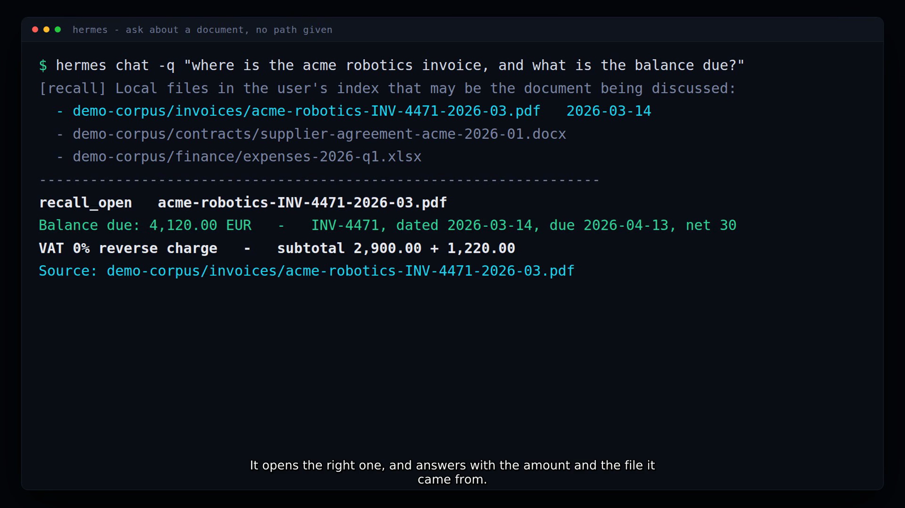
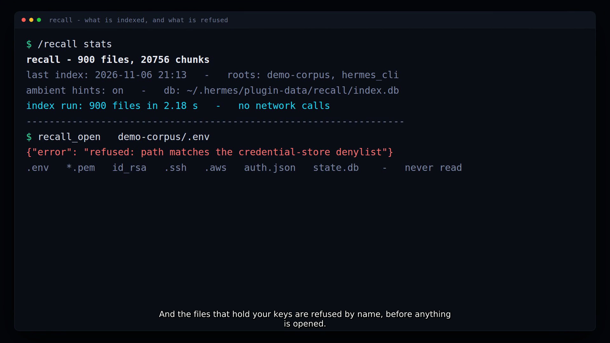

# recall — local file recall for Hermes Agent



Your agent can search the web in one call and your own chat history in another. Neither one can find
the invoice sitting in `~/Downloads`. `recall` indexes the documents already on your machine — content,
not filenames — and puts them in front of the model exactly when a message is about one of them.

> **Demo (58 s):** recorded from this plugin end to end — ask a document question with no path, watch
> the candidates arrive, then the answer plus the file it came from. The still above is a frame from it.

## The gap it fills

| Question | Built-in answer | With `recall` |
| --- | --- | --- |
| "What does the lease say about visitor parking?" | nothing reads your disk | opens the lease, quotes the clause, names the path |
| "Where's the Acme invoice from March?" | `search_files` greps for an exact string you must already know | ranks by content + filename + recency, then `recall_open` reads it |
| "What did the powder coating price do?" | — | matches both the invoice and your cashflow notes |
| "Don't index `~/private`" | — | `recall_forget` drops it; credential stores are refused by name |

Hermes' built-in `search_files` is exact-match search inside one directory; session search covers
conversations; memory providers store facts the agent wrote down. None of them answer *"which of my
40,000 files is the one I'm thinking of?"*. That is the whole product.

## What you get

One local index, three places it shows up:

- **Tools** — `recall_index`, `recall_search`, `recall_open`, `recall_stats`, `recall_forget`.
  Search returns path, modified date, score and a highlighted snippet; `recall_open` reads PDF, Word,
  Excel, PowerPoint, OpenDocument, Markdown, CSV, email and source files as text, with
  `offset`/`max_chars` paging so a long document is never silently truncated.
- **`@recall:` context reference** — `@recall:acme invoice march` (or an absolute path) expands the
  matching passages inline into that turn.
- **Ambient hint (`pre_llm_call` hook)** — when a message reads like it is about a document, up to
  three candidate paths arrive **before** the model answers, each with one highlighted line. The model
  still has to `recall_open` the file, so a hint can accelerate a real lookup and can never invent one.
  Machine-generated turns (cron prompts, gateway notifications) are ignored.

Plus `/recall` in any chat surface:

```
/recall <query>               top matches with score and snippet
/recall index [path]          index or refresh; prints counts
/recall forget <path> | all   drop a folder, or clear the index
/recall stats                 files, chunks, last run, roots
```

Once an index exists, every new session starts a **bounded background refresh** (daemon thread, its own
connection, 25 s / 5,000 files by default), so a file saved yesterday is findable today without anyone
remembering to run a command.

## Install

```bash
hermes plugins install memeshee/hermes-recall
hermes plugins enable recall
```

Then, once:

```
/recall index ~/Documents
```

or just ask: *"index my Documents folder so you can find files for me."* Repeat runs are incremental —
unchanged files are skipped by `mtime` + size.

## A real exchange

```text
you> where is the acme invoice from march, and what's the balance?
     [recall] Local files in the user's index that may be the document being discussed:
     - /home/me/Documents/invoices/acme-robotics-INV-4471-2026-03.pdf (modified 2026-03-14)
       — "Invoice INV-4471 Date 2026-03-14 Payment terms: net 30 … BALANCE DUE 4 120.00 EUR"
     ...
bot> Balance due is 4 120.00 EUR, due 2026-04-13 (net 30).
     Source: /home/me/Documents/invoices/acme-robotics-INV-4471-2026-03.pdf
```

## Measured on one machine

Real numbers from the box this was built on — not a benchmark suite:

- **4,127 files → 101,483 passages indexed in 73 s**, first run, single core, including 847 files
  skipped for type (images, video, audio).
- **Queries: 187–536 ms** each on that index, warm.
- **Incremental re-run: 0 changed, 8 unchanged, 0.3 s** — the cost of staying current.
- Extraction is standard library only: no `pypdf`, no `python-docx`, no `openpyxl`, no embedding
  service, no network call at any point. PDF text layers are read through a FlateDecode-aware stream
  extractor; Office files through their OOXML text nodes.

## What it reads, and what it refuses

Indexed: text and source files, PDF, `.docx`, `.xlsx`, `.pptx`, OpenDocument, HTML, CSV/TSV, `.eml`,
subtitles.

Never read — matched by name **before** a file is opened, and not removable by settings:

```
.env  *.env  .env.*  *.pem  *.key  *.p12  *.pfx  *.keystore
id_rsa*  id_ed25519*  *.kdbx  .netrc  .pgpass  .git-credentials
auth.json  credentials.json  state.db*  .npmrc  .pypirc
.ssh/  .gnupg/  .aws/  .azure/  .kube/  .docker/  .password-store/
node_modules/  .git/  .venv/  __pycache__/  dist/  build/  target/  .cache/
Library/  AppData/  .local/  .Trash/  site-packages/
```



A file whose text cannot be extracted (a scan, an image, an encrypted PDF) is still findable by the
words in its filename, and `recall_stats` reports the skip reasons so the gap is visible rather than
silent.

## Settings

Under `plugins.entries.recall.settings` (Desktop → Plugins → recall, or `hermes config set`):

| Key | Default | Meaning |
| --- | --- | --- |
| `roots` | `~/Documents, ~/Desktop, ~/Downloads, ~/Projects` | folders indexed when no path is given |
| `excludes` | `[]` | extra glob/substring patterns on top of the built-in denylist |
| `ambient` | `true` | allow the `pre_llm_call` hint |
| `max_hints` | `3` | candidate files per turn |
| `max_file_mb` | `8` | larger files are skipped and reported |
| `chunk_chars` | `1200` | characters per indexed passage |
| `max_files` | `20000` | files touched by one run |
| `budget_s` | `90` | wall-clock budget for one run; partial runs resume next call |
| `refresh_on_start` | `true` | background refresh when a session starts (no-op until an index exists) |
| `refresh_budget_s` | `25` | wall-clock budget for one refresh |
| `refresh_max_files` | `5000` | files a refresh inspects |

## Behaviour you can rely on

- **Local only.** No network, no API key, no account, no telemetry. The index is one SQLite file
  (FTS5) under `~/.hermes/plugin-data/recall/`.
- **Incremental.** `(mtime, size)` decides what to re-read; a deleted file is dropped on the next run
  inside a scanned root; the background refresh keeps it honest.
- **Bounded.** Every run stops at `budget_s` / `max_files` and reports `partial: true` instead of
  hanging a turn.
- **Read before quote.** Snippets are previews. The tool descriptions and the bundled skill tell the
  model to `recall_open` a file before quoting it, and to say what it searched for when nothing matches.
- **Quiet.** The ambient hint needs a document cue, two content tokens and a score threshold, never
  shows the same path twice in a session, and ignores system-generated turns.
- **Reversible.** `recall_forget` removes a path or clears the index; the files themselves are never
  touched.

## Honest limits

- **No OCR.** A scanned PDF or a photo of a receipt is findable by filename only; its content is not
  indexed, and `recall_stats` says so.
- **Lexical, not semantic.** Ranking is BM25 plus path/recency/phrase boosts. *"The document where we
  agreed the delivery date"* works; *"the thing that lawyer sent"* only works if those words are in it.
  No embedding model runs — which is why there is no key, no model download and no per-query cost.
- **First run costs time** — roughly 20 ms per file on a warm disk. Point it at the folders that hold
  documents, not at `/`.
- **The index holds extracted text** in plain SQLite. It is refused by its own path rules, but it is
  not encrypted at rest — use `recall_forget` for anything you would not want sitting on disk.
- **One machine, one profile.** Not a shared index; each Hermes profile gets its own database.

## Demo corpus

```bash
python3 examples/make_demo_corpus.py /tmp/demo-corpus
```

Writes a realistic corpus — two invoices (real Flate-compressed PDF), a supplier agreement (`.docx`),
an expenses sheet (`.xlsx`), an office lease, cashflow notes, a fake scan, and a `.env` that must stay
invisible. Use it to try the plugin or to reproduce a bug without touching real documents.

## Tests

```bash
python3 tests/selftest.py     # standard library only, no Hermes install needed
```

Thirteen behavioural checks: content ranking, PDF/Word/Excel extraction, the credential denylist
(including `recall_open` refusing a secret path), name-only recall for an unreadable file, incremental
re-index, thread safety of the shared connection, phrase-over-scatter ranking, forget/clear, and the
ambient hook's four rules (fires for a document question, silent on chit-chat, silent on
machine-generated turns, does not repeat itself).

`hermes plugins validate ./` passes locally — the same gate the catalog CI runs.

## For reviewers: why a plugin and not a skill

A skill can tell the model to run `grep`; it cannot index anything, cannot survive across sessions, and
cannot see a turn before the model does. This plugin uses three public Hermes surfaces a skill has no
access to: `ctx.register_hook("pre_llm_call")` (ambient candidates), `ctx.register_context_reference`
(`@recall:`), and `ctx.register_hook("on_session_start")` (bounded refresh). It imports only the public
plugin API, patches nothing, holds no credentials, and makes no network calls.

## Disclosure

`recall` reads files under the folders you point it at, stores the extracted text in a local SQLite
index under `~/.hermes/plugin-data/recall/`, and injects short excerpts of that text into the model
prompt when a message looks document-related. Text it reads is sent to your configured model provider
during a turn, exactly as any file you show the agent — that is the only place it leaves the machine.
It never modifies, moves or deletes your files, and never persists anything outside its own data
directory.

MIT licensed.
